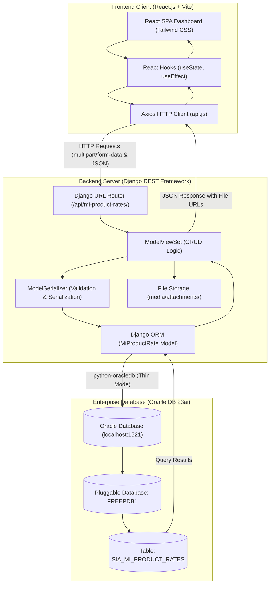

# MI Product Rates Management System

An enterprise full-stack system designed for **SLTMobitel** to manage, track, and audit Product Rates for telecommunication services, executive tiers, rates, statuses, audit trails, and supporting documentation attachments.

> **Database Note:** This project is built using **Oracle Database** instead of PostgreSQL, integrated with **Django ORM**, **Django REST Framework (DRF)**, and **React.js**.

---

## 🏛️ High-Level System Architecture

The application adopts a decoupled client-server architecture:



---

## 🛠️ Technology Stack

- **Database:** Oracle Database 23ai Free (via `python-oracledb` Thin mode)
- **Backend:** Python 3.10+, Django 6.x, Django REST Framework (DRF)
- **Frontend:** React.js (Vite), Axios, Tailwind CSS, Lucide Icons
- **API Testing:** Postman (Collection v2.1.0 included)

---

## 📁 Repository Structure

```text
MI Product Rates/
├── backend/                               # Django REST API Backend
│   ├── manage.py                          # Django management CLI
│   ├── requirements.txt                   # Backend dependencies
│   ├── mi_rates_backend/                  # Core settings & routing
│   │   ├── settings.py                    # Oracle DB, DRF & CORS config
│   │   ├── __init__.py                    # python-oracledb driver setup
│   │   └── urls.py                        # Root URLs & media serving
│   └── rates/                             # MI Rates application
│       ├── models.py                      # SIA_MI_PRODUCT_RATES model & auto SR_ID
│       ├── serializers.py                 # DRF validation & file URL formatting
│       ├── views.py                       # CRUD ModelViewSet
│       └── urls.py                        # App endpoints
├── frontend/                              # React.js SPA (Vite)
│   ├── src/
│   │   ├── App.jsx                        # State orchestration & layout
│   │   ├── services/api.js                # Axios API service
│   │   └── components/                    # Table, Modals & Toast alerts
│   ├── package.json
│   └── vite.config.js
├── docs/                                  # Comprehensive Step-by-Step Guides
│   ├── README.md                          # Documentation Table of Contents
│   ├── 01_PROJECT_OVERVIEW_AND_ARCHITECTURE.md
│   ├── 02_ORACLE_DB_SETUP.md              # Oracle schema, users & python-oracledb config
│   ├── 03_DJANGO_BACKEND_SETUP_AND_MODEL.md # Task 01: Model SIA_MI_PRODUCT_RATES & auto SR_ID
│   ├── 04_DRF_API_DEVELOPMENT.md          # Task 02: CRUD APIs & multipart file upload
│   ├── 05_POSTMAN_API_TESTING_GUIDE.md    # Task 03: Postman test suite & endpoints
│   ├── 06_REACT_FRONTEND_DEVELOPMENT.md   # Tasks 04 & 05: React UI, modals & auto-refresh
│   └── 07_EXECUTION_AND_TROUBLESHOOTING_GUIDE.md # Run guide & common Oracle/Django fixes
├── postman/                               # Ready-to-import Postman Collection
│   └── MI_Product_Rates_API.postman_collection.json
├── README.md                              # Main overview & quick start
└── .gitignore
```

---

## 🚀 Key Features & Deliverables

1. **Oracle Database Table (`SIA_MI_PRODUCT_RATES`):**
   - Created entirely through Django ORM migrations (no manual SQL).
   - Auto-generated sequential Service Rate ID format (`SR001`, `SR002`, ...).
   - Rate validation: `DecimalField(max_digits=12, decimal_places=2)`.
   - Audit trail tracking (`CREATED_DATE`, `CREATED_USER`, `UPDATED_DATE`, `UPDATED_USER`).
   - File attachment support (`ATTACHMENT`) with file type & size security checks.

2. **Backend REST APIs:**
   - `POST /api/mi-product-rates/` — Create new record (supports `multipart/form-data`)
   - `GET /api/mi-product-rates/` — List all records with search and ordering
   - `GET /api/mi-product-rates/<id>/` — Retrieve single record
   - `PUT/PATCH /api/mi-product-rates/<id>/` — Update record
   - `DELETE /api/mi-product-rates/<id>/` — Delete record (with attachment file cleanup)

3. **React.js Frontend:**
   - Clean, responsive dashboard tailored for SLTMobitel enterprise use.
   - Live form validation (positive rates, max 2 decimals).
   - Add/Edit modal form with file upload picker.
   - Delete confirmation popup to prevent accidental data loss.
   - Download/preview link for uploaded attachments.
   - Auto-refresh mechanism on all CRUD operations.

4. **Postman API Test Suite:**
   - Full Postman v2.1.0 collection included in `postman/MI_Product_Rates_API.postman_collection.json`.

---

## ⚡ Quick Start

### 1. Database & Backend Setup
Refer to [02_ORACLE_DB_SETUP.md](docs/02_ORACLE_DB_SETUP.md) and [03_DJANGO_BACKEND_SETUP_AND_MODEL.md](docs/03_DJANGO_BACKEND_SETUP_AND_MODEL.md):

```bash
# Set up Python virtual environment
python -m venv venv
.\venv\Scripts\Activate.ps1  # Windows PowerShell

# Install dependencies
pip install django djangorestframework django-cors-headers oracledb pillow

# Run migrations against Oracle DB
cd backend
python manage.py makemigrations rates
python manage.py migrate

# Run Django development server
python manage.py runserver 8000
```

### 2. Frontend Setup
Refer to [06_REACT_FRONTEND_DEVELOPMENT.md](docs/06_REACT_FRONTEND_DEVELOPMENT.md):

```bash
cd frontend
npm install
npm run dev
```

Visit the application at `http://localhost:5173/`.

---

## 📖 Detailed Documentation

For full implementation code, configuration files, and troubleshooting, review the guides in the [docs/](docs/) folder.
