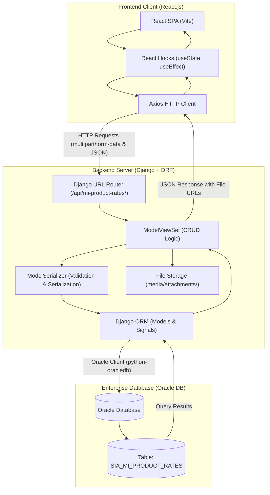

# Document 01: Project Overview & Architecture

## 1. Executive Summary

The **MI Product Rates Management System** is an enterprise-grade full-stack web application designed for SLTMobitel. The system enables business administrators and executives to manage, track, and audit Product Rates for various telecommunication services with associated executive tiers, active/inactive statuses, rate figures, notes, and file attachments (e.g., rate approval documentation).

### Original Requirement vs. Customized Tech Stack
- **Database:** Oracle Database (Customized from PostgreSQL)
- **Backend:** Django 4.2+ / 5.x & Django REST Framework (DRF)
- **Frontend:** React.js (built with Vite for high performance)
- **API Testing & Validation:** Postman (Collection v2.1.0)

---

## 2. High-Level System Architecture

The application adopts a decoupled client-server architecture:



---

## 3. Recommended Project Directory Structure

To keep backend, frontend, documentation, and assets organized cleanly, organize the repository as follows:

```text
MI Product Rates/
├── docs/                                # Step-by-step developer documentation
│   ├── README.md
│   ├── 01_PROJECT_OVERVIEW_AND_ARCHITECTURE.md
│   ├── 02_ORACLE_DB_SETUP.md
│   ├── 03_DJANGO_BACKEND_SETUP_AND_MODEL.md
│   ├── 04_DRF_API_DEVELOPMENT.md
│   ├── 05_POSTMAN_API_TESTING_GUIDE.md
│   ├── 06_REACT_FRONTEND_DEVELOPMENT.md
│   └── 07_EXECUTION_AND_TROUBLESHOOTING_GUIDE.md
├── backend/                             # Django Backend Project
│   ├── manage.py
│   ├── mi_rates_backend/                # Project Configuration
│   │   ├── __init__.py
│   │   ├── settings.py                  # Oracle DB & DRF Settings
│   │   ├── urls.py                      # Main Router & Media URL config
│   │   ├── asgi.py
│   │   └── wsgi.py
│   ├── rates/                           # MI Rates Application
│   │   ├── migrations/
│   │   │   └── __init__.py
│   │   ├── __init__.py
│   │   ├── admin.py                     # Django Admin registration
│   │   ├── apps.py
│   │   ├── models.py                    # SIA_MI_PRODUCT_RATES model
│   │   ├── serializers.py               # DRF Serializers with validation
│   │   ├── views.py                     # ViewSets for CRUD operations
│   │   └── urls.py                      # App-specific endpoints
│   ├── media/                           # Uploaded user attachments
│   │   └── attachments/
│   └── requirements.txt                 # Python dependencies
├── frontend/                            # React.js Frontend (Vite)
│   ├── public/
│   ├── src/
│   │   ├── assets/
│   │   ├── components/
│   │   │   ├── ProductRateTable.jsx     # Main data table view
│   │   │   ├── ProductRateModal.jsx     # Add/Edit modal form
│   │   │   ├── DeleteConfirmModal.jsx   # Delete confirmation popup
│   │   │   └── Toast.jsx                # Success/Error notification alerts
│   │   ├── services/
│   │   │   └── api.js                   # Axios instance & API calls
│   │   ├── App.jsx                      # Main UI orchestration
│   │   ├── index.css                    # Tailwind CSS or custom styles
│   │   └── main.jsx
│   ├── package.json
│   ├── vite.config.js
│   └── tailwind.config.js
└── postman/                             # Postman Collection & Environment
    └── MI_Product_Rates_API.postman_collection.json
```

---

## 4. Key Functional Requirements

1. **Database Table `SIA_MI_PRODUCT_RATES`:**
   - Generated entirely through Django ORM migrations (no manual SQL scripts executed directly).
   - Auto-incrementing primary key `ID`.
   - Unique auto-generated `SR_ID` format (e.g., `SR001`, `SR002`, `SR003`...).
   - Precision rate handling: `DecimalField(max_digits=12, decimal_places=2)`.
   - File attachment handling via `FileField`.
   - Audit fields: `CREATED_DATE`, `CREATED_USER`, `UPDATED_DATE`, `UPDATED_USER`.

2. **REST API Endpoints:**
   - Full CRUD operations via `/api/mi-product-rates/`.
   - Support for `multipart/form-data` payloads to accept both text fields and binary file uploads.

3. **React Frontend:**
   - Responsive and clean UI designed for enterprise telecommunication management.
   - Live form validation (rate decimals, required fields).
   - Instant file upload selection and download links for existing attachments.
   - Delete confirmation dialog to prevent accidental data loss.
   - Auto-refresh mechanism on add, update, and delete actions.

4. **Postman API Suite:**
   - Fully documented requests with sample payload, query parameters, multipart file upload guide, and test assertion scripts.

---

## 5. Prerequisites Checklist

Before proceeding to subsequent chapters, verify the following tools are installed on your workstation:

- [ ] **Python 3.10+** (`python --version`)
- [ ] **Node.js 18+ & npm** (`node --version` and `npm --version`)
- [ ] **Oracle Database** (Oracle XE 21c/18c/11g, Oracle 19c, or Oracle Database 23ai Free)
- [ ] **Postman Desktop Client** (for API testing)
- [ ] **Git** (optional, for version control)
