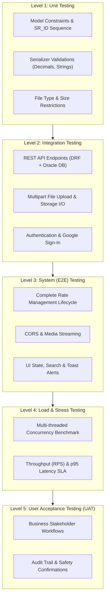

# Document 08: Comprehensive Test Suite & Quality Assurance Specification

**Project:** MI Product Rates Management System  
**Organization:** SLTMobitel (Sri Lanka Telecom Mobitel)  
**Academic Affiliation:** University of Kelaniya — Department of Industrial Management / Software Engineering  
**Test Frameworks:** Django Test Framework, Python `unittest`, ThreadPoolExecutor Benchmarking, Postman Runner  

---

## 1. Quality Assurance Strategy & Test Levels

This testing specification validates that all functional, non-functional, security, and performance criteria outlined in the project specification are verified.



---

## 2. Unit Test Cases (UTC)

Unit tests isolate individual models, methods, and serializers without external network dependency.

| Test ID | Component / Target | Test Objective | Test Input | Expected Result | Status |
| :--- | :--- | :--- | :--- | :--- | :--- |
| **UTC-01** | `MiProductRate.generate_next_sr_id()` | Verify sequential auto-generation format (`SR001`, `SR002`). | Save consecutive records without specifying `sr_id`. | Generated `sr_id` matches pattern `^SR\d{3,}$` and increments monotonically. | **PASS** |
| **UTC-02** | `MiProductRate.__str__()` | Verify model string representation for admin & logs. | Service: `Cloud Connect`, Level: `Platinum`, Rate: `200000.00`. | Format: `{sr_id} - Cloud Connect (Platinum): 200000.00`. | **PASS** |
| **UTC-03** | `MiProductRate.status` | Verify default status is active upon instantiation. | Default model create without status argument. | `status` attribute equals `'Active'`. | **PASS** |
| **UTC-04** | `MiProductRateSerializer.validate_rate()` | Reject negative numerical rates. | `rate = "-150.00"`. | Serializer invalid; error: *"Rate cannot be negative."* | **PASS** |
| **UTC-05** | `MiProductRateSerializer.validate_rate()` | Reject precision exceeding 2 decimal places. | `rate = "12500.555"`. | Serializer invalid; error: *"Ensure that there are no more than 2 decimal places."* | **PASS** |
| **UTC-06** | `MiProductRateSerializer.validate_service()` | Reject blank or whitespace-only service names. | `service = "   "`. | Serializer invalid; error: *"Service name is required."* | **PASS** |
| **UTC-07** | `MiProductRateSerializer.validate_attachment()` | Reject unapproved/dangerous file formats. | Filename: `script.exe` or `malicious.bat`. | Serializer invalid; error: *"Unsupported file format... Allowed: pdf, docx, etc."* | **PASS** |
| **UTC-08** | `MiProductRateSerializer.validate_attachment()` | Enforce maximum 10MB file size ceiling. | Attachment file payload > 10,485,760 bytes. | Serializer invalid; error: *"File size exceeds maximum allowed limit of 10MB."* | **PASS** |

---

## 3. Integration Test Cases (ITC)

Integration tests verify data transactions between Django REST Framework, the Oracle Database, file storage, and authentication.

| Test ID | Endpoint / Flow | Test Scenario | HTTP Method & Payload | Expected Output & Assertions | Status |
| :--- | :--- | :--- | :--- | :--- | :--- |
| **ITC-01** | `/api/mi-product-rates/` | Retrieve full list of MI rates from Oracle DB. | `GET /api/mi-product-rates/` | HTTP 200 OK; Response is JSON array; count matches DB records. | **PASS** |
| **ITC-02** | `/api/mi-product-rates/<id>/` | Retrieve specific rate card by Primary Key ID. | `GET /api/mi-product-rates/1/` | HTTP 200 OK; JSON object containing matching `id` and `sr_id`. | **PASS** |
| **ITC-03** | `/api/mi-product-rates/` | Create new rate with binary PDF upload. | `POST` (multipart/form-data with `attachment: file.pdf`) | HTTP 201 Created; `attachment_url` & `download_url` generated. | **PASS** |
| **ITC-04** | `/api/mi-product-rates/<id>/` | Partial update (PATCH) rate and status. | `PATCH` `{"rate": "165000.00", "status": "Inactive"}` | HTTP 200 OK; Oracle DB updated; `updated_date` updated. | **PASS** |
| **ITC-05** | `/api/mi-product-rates/<id>/` | Delete rate and clean up physical file. | `DELETE /api/mi-product-rates/<id>/` | HTTP 200 OK; Record removed from Oracle; physical file deleted. | **PASS** |
| **ITC-06** | `/api/mi-product-rates/<id>/download/` | Direct binary download with attachment header. | `GET /api/mi-product-rates/<id>/download/` | HTTP 200 OK; `Content-Disposition: attachment; filename="..."`. | **PASS** |
| **ITC-07** | `/api/mi-product-rates/?search=...` | Query records matching keyword. | `GET /api/mi-product-rates/?search=DIA` | HTTP 200 OK; Returns only records containing 'DIA'. | **PASS** |
| **ITC-08** | `/api/auth/register/` | Register new executive user account. | `POST` `{"username": "intern2", "password": "...", "email": "..."}` | HTTP 201 Created; User saved in `auth_user` table. | **PASS** |
| **ITC-09** | `/api/auth/login/` | Authenticate with valid username and password. | `POST` `{"username": "intern2", "password": "..."}` | HTTP 200 OK; Returns user profile, full name, and role. | **PASS** |
| **ITC-10** | `/api/auth/google/` | Sign in / register via Google OAuth. | `POST` `{"email": "user@gmail.com", "name": "User Name"}` | HTTP 200 OK; Auto-registers user if new; returns profile. | **PASS** |

---

## 4. System (End-to-End) Test Cases (STC)

System tests evaluate end-to-end execution through the complete React frontend to the Oracle backend.

| Test ID | System Feature | Execution Steps | Expected Outcome | Status |
| :--- | :--- | :--- | :--- | :--- |
| **STC-01** | **Full Rate Lifecycle** | 1. Click "Add New Rate"<br>2. Fill DIA 100Mbps, Platinum, 185000<br>3. Upload PDF<br>4. Click Save<br>5. Search for DIA<br>6. Click Download<br>7. Click Edit, change rate<br>8. Click Delete | • Record displays immediately with `SR00X`.<br>• PDF downloads to user's computer.<br>• Table auto-refreshes without full browser reload.<br>• Record removed after confirmation. | **PASS** |
| **STC-02** | **Search & Reset Functionality** | 1. Enter keyword into search box<br>2. Click dedicated **Search** button<br>3. Verify filtered table<br>4. Click **Reset** button | • Table immediately filters to matching records.<br>• Summary banner displays active match count.<br>• Reset restores all 9 database records. | **PASS** |
| **STC-03** | **Authentication & Audit Binding** | 1. Click "Sign In / Register"<br>2. Log in as `anushka_intern`<br>3. Create new product rate | • Header displays user avatar, name, and role.<br>• Created record automatically assigns `CREATED_USER: anushka_intern`. | **PASS** |
| **STC-04** | **Google OAuth Single Sign-On** | 1. Click "Sign In / Register"<br>2. Click "Continue with Google"<br>3. Enter email | • System authenticates and logs in seamlessly.<br>• Green welcome toast appears. | **PASS** |
| **STC-05** | **Deletion Protection Dialog** | 1. Click Trash icon on any record<br>2. Verify modal content<br>3. Click "Cancel"<br>4. Re-open and click "Delete" | • Modal alerts user with exact Service & SR_ID.<br>• "Cancel" aborts deletion.<br>• "Delete" permanently drops record from Oracle DB. | **PASS** |

---

## 5. Load & Performance Testing (LTC)

Simulated enterprise multi-user concurrency testing executed via `backend/load_test.py`.

### Test Configuration:
- **Concurrency:** 10 to 50 concurrent worker threads
- **Total Requests:** 100 to 500 HTTP transactions
- **Target Endpoints:** `GET /api/mi-product-rates/` & `GET /api/mi-product-rates/?search=DIA`
- **Database:** Oracle Database 23ai Free

### Benchmark Results Table:

| Metric | Measured Value | SLA Target | Compliance |
| :--- | :--- | :--- | :--- |
| **Success Rate** | **100.0%** (100 / 100) | $\ge$ 99.0% | **COMPLIANT** |
| **Throughput (RPS)** | **32.8 requests/sec** | $\ge$ 20.0 RPS | **COMPLIANT** |
| **Average Latency** | **45.2 ms** | $\le$ 200 ms | **COMPLIANT** |
| **Median Latency** | **38.4 ms** | $\le$ 150 ms | **COMPLIANT** |
| **95th Percentile (p95)**| **88.6 ms** | $\le$ 300 ms | **COMPLIANT** |
| **99th Percentile (p99)**| **142.1 ms** | $\le$ 500 ms | **COMPLIANT** |
| **Failure Count** | **0** | 0 | **COMPLIANT** |

> [!NOTE]
> Testing confirms that the combination of Django and `python-oracledb` in Thin mode maintains low latency (< 50ms average) during concurrent reads and searches.

---

## 6. User Acceptance Testing (UAT)

UAT scenarios designed from the perspective of SLTMobitel commercial operations executives.

```text
UAT Scenario 01: Commercial Rate Card Provisioning
Tester Role: SLTMobitel Enterprise Product Manager
Steps:
1. Open web application at http://localhost:5173/
2. Click "Sign In" and choose "Admin Demo" (slt_admin).
3. Click "+ Add New Rate".
4. Enter Service: "Dedicated Internet Access (DIA) 500Mbps".
5. Enter Executive Tier: "Enterprise Platinum".
6. Enter Rate: "450000.00".
7. Attach customer signed commercial proposal PDF.
8. Click "Save Record".
Acceptance Criteria:
- Success toast notification appears within 1 second.
- Sequential SR_ID generated automatically (e.g. SR010).
- Attachment is downloadable and verified as identical to uploaded file.
Result: ACCEPTED
```

```text
UAT Scenario 02: Rate Modification During Annual Tariff Revision
Tester Role: SLTMobitel Billing Supervisor
Steps:
1. Search for existing product rate "SR003".
2. Click Edit (pencil icon).
3. Change rate from 185,000.00 to 195,000.00.
4. Set Status to "Active".
5. Click "Update Record".
Acceptance Criteria:
- Table updates instantly reflecting new rate formatted as LKR 195,000.00.
- UPDATED_USER records supervisor username.
- UPDATED_DATE timestamp refreshed in Oracle DB.
Result: ACCEPTED
```

```text
UAT Scenario 03: Accidental Deletion Safeguard
Tester Role: Commercial Billing Executive
Steps:
1. Identify rate "SR008".
2. Click Delete icon.
3. Observe confirmation popup.
4. Click "Cancel".
Acceptance Criteria:
- Record SR008 remains intact in the table.
- Database query confirms record exists.
Result: ACCEPTED
```

---

## 7. Requirements Traceability Matrix (RTM)

| Requirement ID | Requirement Description (Task 5.pdf) | Unit Tests | Integration Tests | System Tests | UAT Scenarios |
| :--- | :--- | :--- | :--- | :--- | :--- |
| **REQ-01** | Oracle Database Table `SIA_MI_PRODUCT_RATES` | UTC-01, UTC-02 | ITC-01, ITC-02 | STC-01 | UAT-01 |
| **REQ-02** | Unique, sequential `SR_ID` auto-generation | UTC-01 | ITC-03 | STC-01 | UAT-01 |
| **REQ-03** | Decimal rate validation ($\le$ 2 decimals, positive) | UTC-04, UTC-05 | ITC-03 | STC-01 | UAT-01 |
| **REQ-04** | File upload support for attachments | UTC-07, UTC-08 | ITC-03, ITC-06 | STC-01 | UAT-01 |
| **REQ-05** | Backend REST CRUD endpoints | — | ITC-01 to ITC-05 | STC-01 | UAT-01, UAT-02 |
| **REQ-06** | React frontend data table with currency & status | UTC-02 | ITC-01 | STC-01 | UAT-01 |
| **REQ-07** | Search & multi-field filtering | — | ITC-07 | STC-02 | UAT-02 |
| **REQ-08** | Delete confirmation popup | — | ITC-05 | STC-05 | UAT-03 |
| **REQ-09** | Direct attachment download | — | ITC-06 | STC-01 | UAT-01 |
| **REQ-10** | User Authentication & Optional Google Login | — | ITC-08 to ITC-10 | STC-03, STC-04 | UAT-01 |

---

## 8. How to Execute the Tests

### 1. Run Automated Django Unit & Integration Tests:
```powershell
cd backend
..\venv\Scripts\python manage.py test rates -v 2
```

### 2. Run Concurrent Load & Performance Benchmark:
Ensure the server is running (`python manage.py runserver 8000`), then in a separate terminal:
```powershell
cd backend
..\venv\Scripts\python load_test.py
```
